# 📦 CargoTrack – Kargo Takip ve Yönetim Sistemi

CargoTrack, bir kargo firmasının operasyonel süreçlerini dijital ortamda yönetmek amacıyla geliştirilmiş ASP.NET Core MVC tabanlı bir kargo takip ve yönetim uygulamasıdır.

Uygulama; kargo oluşturma, gönderi takibi, şube yönetimi, transfer merkezi operasyonları, teslimat işlemleri, başarısız teslimat yönetimi ve kullanıcı yetkilendirme gibi süreçleri tek bir sistem üzerinden yürütmeyi amaçlamaktadır.

Proje, gerçek bir kargo firmasının temel işleyişini örnek alarak geliştirilmiştir. Sistem içerisinde Admin, Manager ve User olmak üzere farklı kullanıcı rolleri bulunur. Her rol, kendi yetki alanına uygun ekranlara ve işlemlere erişir.

---

# 📌 İçindekiler

- [Proje Amacı](#-proje-amacı)
- [Sistem Genel Bakış](#-sistem-genel-bakış)
- [Kargo Operasyon Süreci](#-kargo-operasyon-süreci)
- [Kargo Durumları](#-kargo-durumları)
- [Kullanıcı Rolleri ve Yetkiler](#-kullanıcı-rolleri-ve-yetkiler)
- [Uygulama Modülleri](#-uygulama-modülleri)
- [Veritabanı Yapısı](#-veritabanı-yapısı)
- [Mimari Yapı](#-mimari-yapı)
- [Kullanılan Teknolojiler](#-kullanılan-teknolojiler)
- [Validasyon ve Güvenlik](#-validasyon-ve-güvenlik)
- [Proje Ekran Görüntüleri](#-proje-ekran-görüntüleri)
- [Geliştirici](#-geliştirici)

---

# 🎯 Proje Amacı

CargoTrack'in temel amacı, kargo firmalarında gerçekleştirilen operasyonel işlemleri merkezi bir sistem üzerinden yönetilebilir hâle getirmektir.

Geleneksel kargo takip sistemlerinde yalnızca gönderinin mevcut durumunu görüntülemek yeterli değildir. Gönderinin hangi şubeden çıktığı, hangi transfer merkezlerinden geçtiği, hangi şubeye ulaştığı, teslimat sürecinde yaşanan sorunlar ve geçmiş hareketleri de takip edilebilmelidir.

Bu doğrultuda CargoTrack'te:

- Kargo gönderim ve teslimat süreçlerinin yönetilmesi,
- Şubeler ve transfer merkezleri arasındaki operasyonların takip edilmesi,
- Kullanıcıların yalnızca yetkili oldukları işlemleri gerçekleştirmesi,
- Kargo hareketlerinin geçmişe dönük izlenebilmesi,
- Teslimat başarısızlıklarının kayıt altına alınması,
- Kargo fiyatlandırma bilgilerinin yönetilmesi,
- Yönetimsel işlemlerin denetlenebilir olması

hedeflenmiştir.

---

# 🔄 Sistem Genel Bakış

CargoTrack üç temel kullanıcı rolü üzerine kuruludur:

| Kullanıcı Rolü | Temel Sorumluluk |
|---|---|
| Admin | Sistemin genel yönetimi ve tanımlama işlemleri |
| Manager | Kendisine bağlı şubenin kargo operasyonlarının yönetimi |
| User | Kendi gönderilerini takip etme ve müşteri işlemleri |

Sistem içerisinde kullanıcı kimlik doğrulama işlemleri ASP.NET Core Identity ile gerçekleştirilir. Rol bazlı yetkilendirme sayesinde kullanıcılar yalnızca kendi rollerine uygun alanlara erişebilir.

Uygulamanın genel işleyişi aşağıdaki süreçlerden oluşur:

1. Yönetim tarafından şube, şehir, personel ve transfer merkezi bilgilerinin tanımlanması.
2. Müşterinin sisteme kayıt olması veya mevcut hesabıyla giriş yapması.
3. Yetkili şube personeli tarafından gönderi bilgilerinin sisteme girilmesi.
4. Kargonun çıkış şubesinde işleme alınması.
5. Gerekli durumlarda transfer merkezi ve varış şubesi süreçlerinin yürütülmesi.
6. Kargonun dağıtıma çıkarılması.
7. Teslimatın tamamlanması veya başarısız teslimat kaydının oluşturulması.
8. Kargo hareketlerinin müşteri tarafından takip edilebilmesi.

---

# 🚚 Kargo Operasyon Süreci

CargoTrack'in temel işlevi kargonun oluşturulmasından alıcıya teslim edilmesine kadar geçen sürecin yönetilmesidir.

## 1. Şube ve Operasyon Tanımlamaları

Kargo operasyonlarının gerçekleştirilebilmesi için öncelikle sistemin temel tanımlamalarının yapılması gerekir.

Admin paneli üzerinden:

- Şehir bilgileri,
- Şube bilgileri,
- Şube adresleri,
- Personel bilgileri,
- Transfer merkezi bilgileri,
- Kargo fiyatlandırma bilgileri

yönetilir.

Şubeler şehirlerle ilişkilendirilir. Personeller ise görev yaptıkları şubelerle ilişkilendirilir.

Bu yapı sayesinde kargo operasyonlarının hangi şubeye ait olduğu belirlenebilir.

## 2. Kargo Oluşturma

Manager paneli üzerinden yeni bir kargo kaydı oluşturulabilir.

Kargo oluşturma sürecinde temel olarak aşağıdaki bilgiler kullanılır:

- Gönderici müşteri bilgileri,
- Alıcı müşteri bilgileri,
- Çıkış şubesi,
- Varış şubesi,
- Kargo türü,
- Teslimat türü,
- Ağırlık ve desi bilgileri,
- Kargo boyutları,
- Beyan edilen değer,
- Tahmini teslimat tarihi.

Her kargo için benzersiz bir takip kodu bulunur. Bu kod, gönderinin sistem üzerinden sorgulanmasını sağlar.

Kargo kaydı oluşturulduğunda başlangıç durumu `Created` olarak belirlenir.

## 3. Çıkış Şubesi İşlemleri

Oluşturulan kargo, çıkış şubesine ait operasyonel süreçlere dahil edilir.

Bu aşamada kargonun çıkış şubesi, varış şubesi ve gönderi bilgileri üzerinden takibi gerçekleştirilir.

Kargo hareketleri `CargoMovement` yapısı üzerinden kayıt altına alınır. Böylece gönderinin durum değişiklikleri geçmişe dönük olarak izlenebilir.

## 4. Transfer Merkezi Süreci

Çıkış ve varış şubeleri farklı lokasyonlarda olduğunda gönderinin transfer merkezleri üzerinden ilerlemesi mümkündür.

Transfer merkezleri sistem içerisinde ayrı varlıklar olarak tanımlanır.

Kargo hareketleri aracılığıyla gönderinin transfer sürecindeki durum değişiklikleri takip edilebilir.

Bu yapı, kargonun yalnızca mevcut konumunu değil, operasyonel geçmişini de görüntülemeyi amaçlar.

## 5. Varış Şubesi İşlemleri

Kargo varış şubesine ulaştığında `AtDestinationBranch` durumuna geçer.

Bu aşamadan sonra gönderi, alıcıya ulaştırılmak üzere teslimat sürecine hazırlanır.

## 6. Dağıtıma Çıkarma

Kargo teslimat için dağıtıma çıkarıldığında `OutForDelivery` durumuna geçer.

Bu durum, gönderinin varış şubesinden ayrılarak alıcıya ulaştırılmak üzere dağıtım sürecinde olduğunu ifade eder.

## 7. Teslimat İşlemi

Teslimat başarılı olduğunda sistemde bir `Delivery` kaydı oluşturulur.

Teslimat kaydında:

- Teslimat kodu,
- Teslimatın gerçekleştirildiği kişi,
- Teslimat zamanı,
- Kod doğrulama bilgisi

gibi bilgiler tutulur.

Teslimat tamamlandığında kargo durumu `Delivered` olarak güncellenir.

## 8. Başarısız Teslimat ve İade Süreci

Her teslimat girişimi başarılı sonuçlanmayabilir.

Alıcının adreste bulunmaması, adresin hatalı olması, kargonun hasarlı olması veya alıcının gönderiyi kabul etmemesi gibi durumlar teslimat başarısızlığına neden olabilir.

Bu durumlar `DeliveryException` yapısı üzerinden kayıt altına alınır.

Başarısız teslimatlarda:

- Başarısızlık nedeni belirlenir.
- İlgili kargo ile teslimat istisnası ilişkilendirilir.
- Kargo durumu `DeliveryFailed` olarak güncellenir.

İade sürecine alınan gönderiler `ReturnInProgress` durumuyla takip edilir. Göndericiye iade işlemi tamamlandığında kargo `ReturnedToSender` durumuna geçirilir.

---

# 📍 Kargo Durumları

CargoTrack içerisinde kargonun yaşam döngüsünü temsil eden `CargoStatus` enum yapısı bulunmaktadır.

| Durum | Açıklama |
|---|---|
| Created | Kargo kaydının oluşturulması |
| AtOriginBranch | Kargonun çıkış şubesinde bulunması |
| InTransferCenter | Kargonun transfer merkezi sürecinde olması |
| AtDestinationBranch | Kargonun varış şubesine ulaşması |
| OutForDelivery | Kargonun dağıtıma çıkarılması |
| Delivered | Kargonun başarıyla teslim edilmesi |
| DeliveryFailed | Teslimatın başarısız olması |
| ReturnInProgress | Kargonun göndericiye iade sürecinde olması |
| ReturnedToSender | Kargonun göndericiye iade edilmesi |

Bu durumlar, gönderinin operasyonel sürecinin takip edilmesini sağlar.

Kargo durum değişiklikleri `CargoMovement` kayıtları üzerinden izlenir. Böylece gönderinin önceki ve yeni durumu, hareket zamanı ve ilgili operasyonel bilgiler kayıt altına alınabilir.

---

# 🗄️ Veritabanı Yapısı

CargoTrack, Microsoft SQL Server üzerinde çalışan ilişkisel bir veritabanı kullanır.

Veritabanı işlemleri Entity Framework Core aracılığıyla gerçekleştirilir. Entity yapıları ve ilişkileri Code First yaklaşımıyla tanımlanmıştır.

## Temel Entity Yapıları

| Entity | Açıklama |
|---|---|
| AppUser | ASP.NET Core Identity kullanıcı bilgileri |
| Customer | Müşteri bilgileri ve kullanıcı ilişkisi |
| Employee | Personel bilgileri ve görev yaptığı şube |
| Branch | Kargo şubeleri |
| City | Şehir bilgileri |
| Cargo | Gönderi bilgileri ve kargo yaşam döngüsü |
| CargoMovement | Kargo durum ve hareket geçmişi |
| TransferCenter | Transfer merkezi bilgileri |
| Delivery | Teslimat bilgileri |
| DeliveryException | Başarısız teslimat ve istisna kayıtları |
| CargoPrice | Kargo fiyatlandırma bilgileri |
| Address | Adres bilgileri |
| AuditLog | Sistem işlem kayıtları |
| About | Hakkımızda içerikleri |

## Entity İlişkileri

- `AppUser` ile `Customer` arasında kullanıcı ve müşteri ilişkisi bulunur.
- `AppUser` ile `Employee` arasında kullanıcı ve personel ilişkisi bulunur.
- `Employee`, görev yaptığı `Branch` ile ilişkilendirilir.
- `Branch`, şehir bilgisi için `City` ile ilişkilendirilir.
- `Cargo`, gönderici ve alıcı müşterilerle ilişkilendirilir.
- `Cargo`, çıkış ve varış şubeleriyle ilişkilendirilir.
- `CargoMovement`, ilgili kargonun hareket geçmişini tutar.
- `Delivery`, teslimat bilgilerini ilgili kargo ile ilişkilendirir.
- `DeliveryException`, teslimat sırasında oluşan istisnaları ilgili kargo ile ilişkilendirir.
- `TransferCenter`, transfer merkezi operasyonlarının ve kargo hareketlerinin yönetiminde kullanılır.

### Veritabanı ER Diyagramı

ER diyagramı buraya eklenecektir.

---

# 🏗️ Mimari Yapı

CargoTrack, N-Katmanlı Mimari (N-Tier Architecture) yaklaşımıyla geliştirilmiştir.

Bu mimari sayesinde uygulamanın kullanıcı arayüzü, iş kuralları, veri erişim işlemleri ve domain modelleri birbirinden ayrılmıştır.

## Katmanlar

### 1. Presentation Layer
Kullanıcı ile uygulama arasındaki etkileşimi yönetir.

Bu katmanda:
- MVC Controller yapıları,
- Area tabanlı modüller,
- Razor View dosyaları,
- ViewComponent yapıları,
- Kullanıcı arayüzleri,
- ViewModel sınıfları

bulunur.

Admin, Manager ve User alanları Area yapısı kullanılarak birbirinden ayrılmıştır.

### 2. Business Layer
Uygulamanın iş kurallarını ve operasyonel süreçlerini yönetir.

Bu katmanda:
- Servis sınıfları,
- İş mantığı,
- DTO dönüşümleri,
- Validasyon işlemleri,
- Repository ve diğer katmanlarla koordinasyon

gerçekleştirilir.

Controller sınıfları doğrudan veritabanı işlemleriyle ilgilenmek yerine ilgili servisler üzerinden işlem yapar.

### 3. Data Access Layer
Veritabanı erişiminden sorumludur.

Bu katmanda:
- Entity Framework Core,
- AppDbContext,
- Repository yapıları,
- Veritabanı sorguları,
- CRUD işlemleri,
- Entity ilişkileri ve yapılandırmaları

bulunur.

### 4. Entity Layer
Uygulamanın temel veri modellerini ve domain yapılarını içerir.

Kargo, müşteri, personel, şube, teslimat ve diğer temel entity sınıfları bu katmanda tanımlanır.

Ayrıca kargo türü, teslimat türü ve kargo durumu gibi enum yapıları bulunur.

### 5. DTO Layer
Katmanlar arasında veri aktarımını sağlamak amacıyla kullanılır.

DTO sınıfları sayesinde veritabanı entity'leri ile kullanıcı arayüzünde ihtiyaç duyulan veriler birbirinden ayrılır.

## Kullanılan Tasarım Yaklaşımları

- N-Tier Architecture
- Repository Pattern
- Dependency Injection
- DTO Pattern
- Separation of Concerns
- Code First yaklaşımı

---

# 🛠️ Kullanılan Teknolojiler

| Kategori | Teknoloji |
|---|---|
| Programlama Dili | C# |
| Web Framework | ASP.NET Core MVC |
| ORM | Entity Framework Core |
| Veritabanı | Microsoft SQL Server |
| Kimlik Doğrulama | ASP.NET Core Identity |
| Mimari | N-Katmanlı Mimari |
| Veri Erişimi | Repository Pattern |
| Nesne Eşleme | Mapster |
| Validasyon | FluentValidation |
| Model Doğrulama | Data Annotations |
| Frontend | HTML, CSS, JavaScript |
| UI | Bootstrap, Tailwind CSS |
| İstemci Tarafı | jQuery, AJAX |
| Test ve Dokümantasyon Araçları | Postman, Swagger |
| Versiyon Kontrolü | Git, GitHub |

---

# 🔐 Validasyon ve Güvenlik

CargoTrack'te kullanıcı kimlik doğrulama ve yetkilendirme işlemleri ASP.NET Core Identity üzerinden gerçekleştirilir.

Uygulamada:

- Kullanıcı kayıt ve giriş işlemleri,
- Rol bazlı yetkilendirme,
- Admin, Manager ve User alanlarının ayrılması,
- Kullanıcı ve personel bilgilerinin ilişkilendirilmesi,
- FluentValidation ve Data Annotations ile veri doğrulama,
- Entity ilişkilerinin ve veritabanı kısıtlarının yapılandırılması

gibi mekanizmalar kullanılmaktadır.

Bu yapı, kullanıcıların yalnızca yetkili oldukları alanlara erişmesini ve uygulamaya gönderilen verilerin doğrulanmasını amaçlar.

---

# 📸 Proje Ekran Görüntüleri

CargoTrack'in kullanıcı arayüzleri ve operasyonel ekranları bu bölümde gösterilecektir.

### Genel Kullanıcı Arayüzü
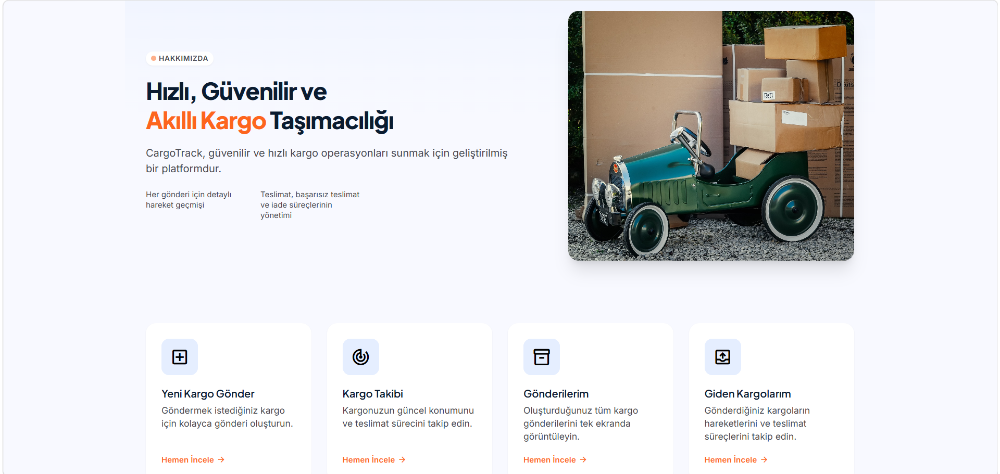
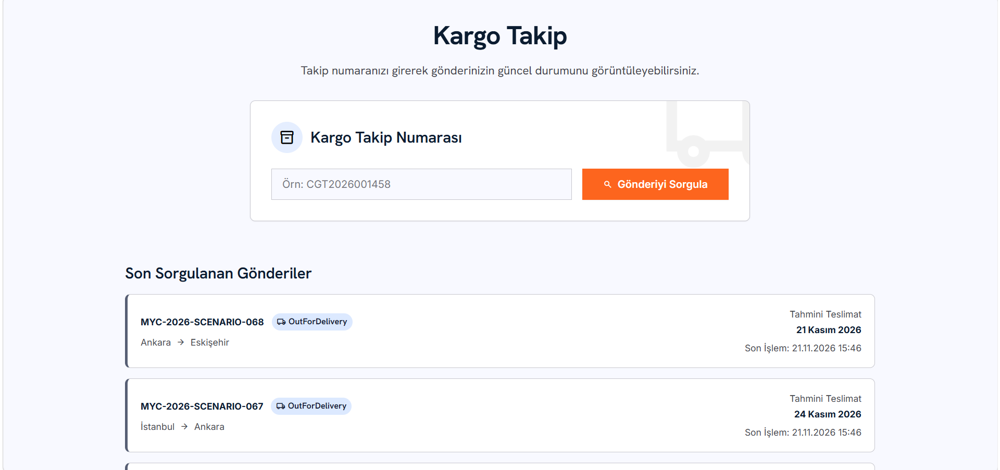

### Admin Paneli
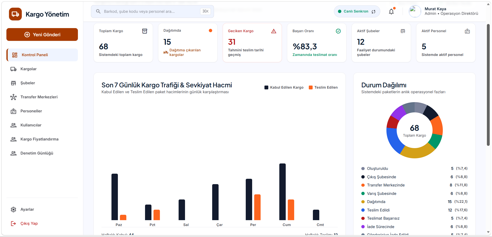
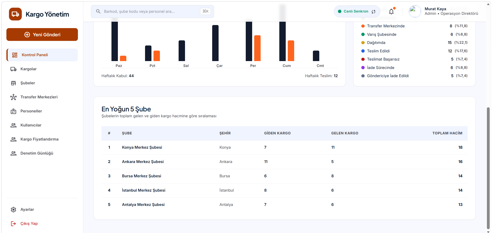
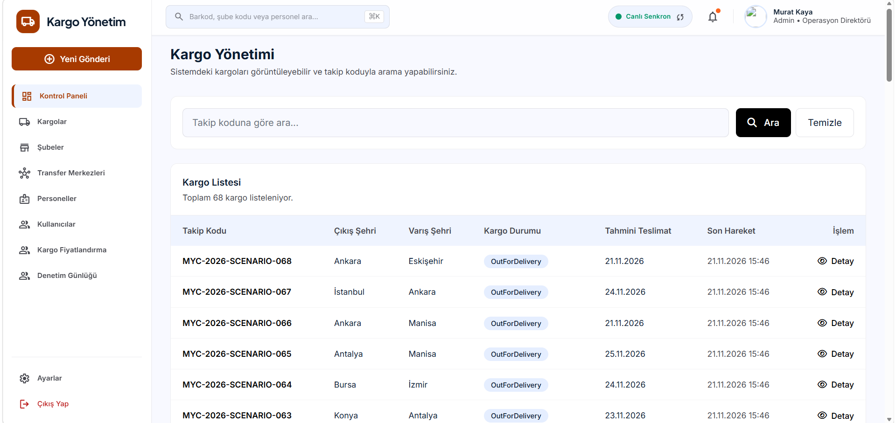
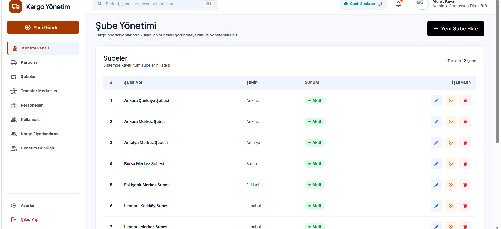
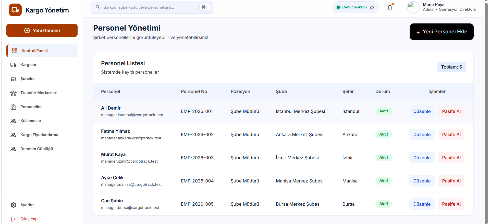
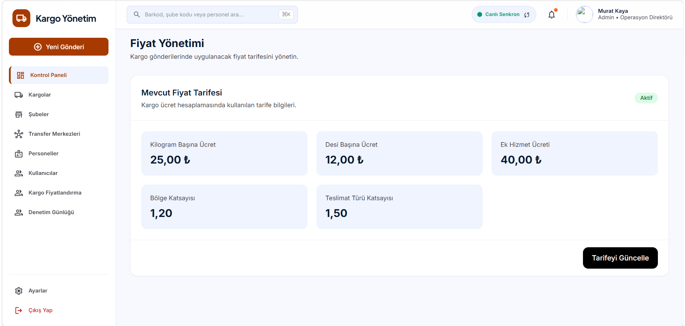
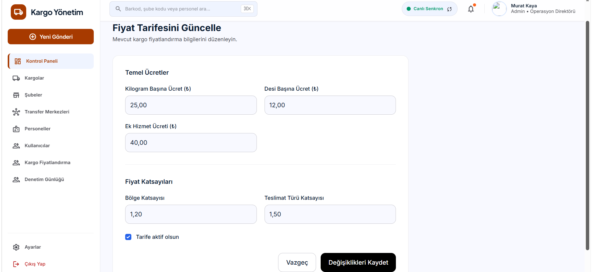
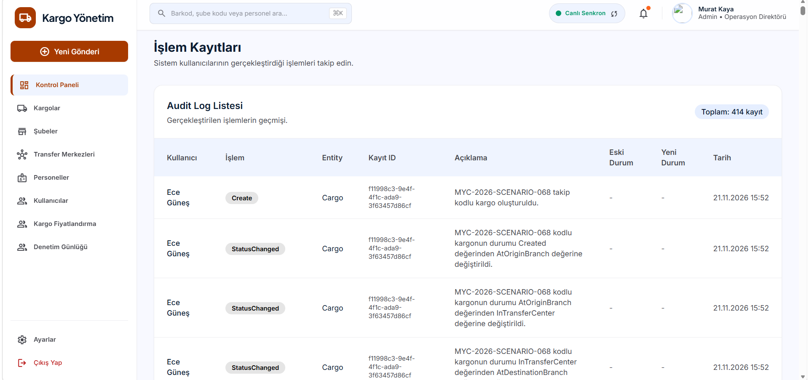

### Manager Paneli
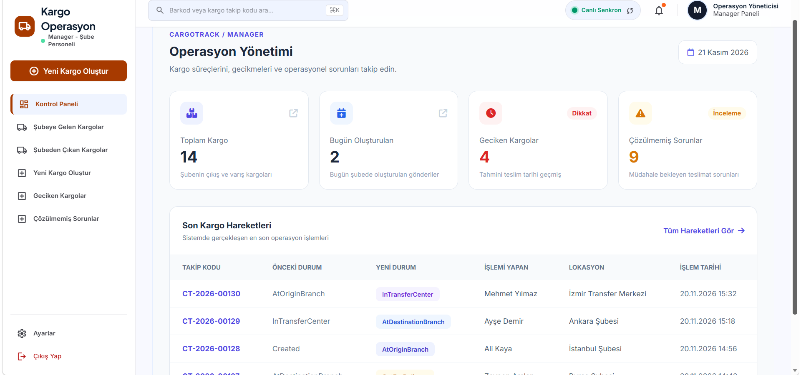
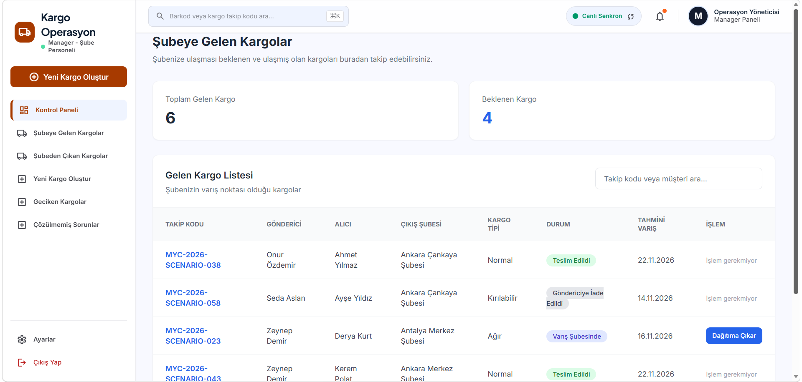
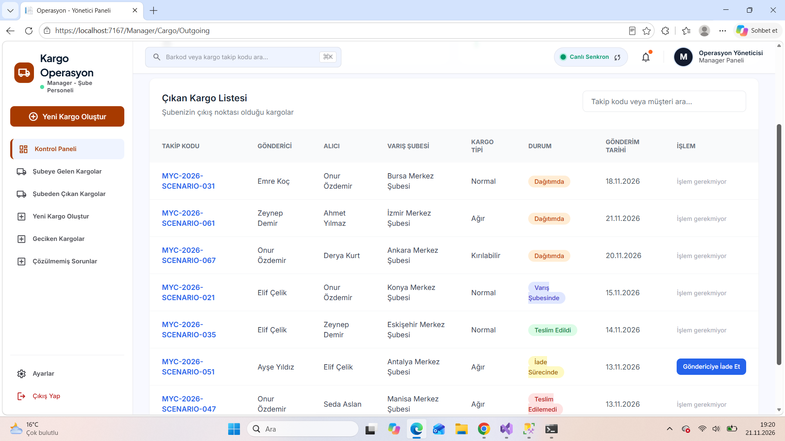
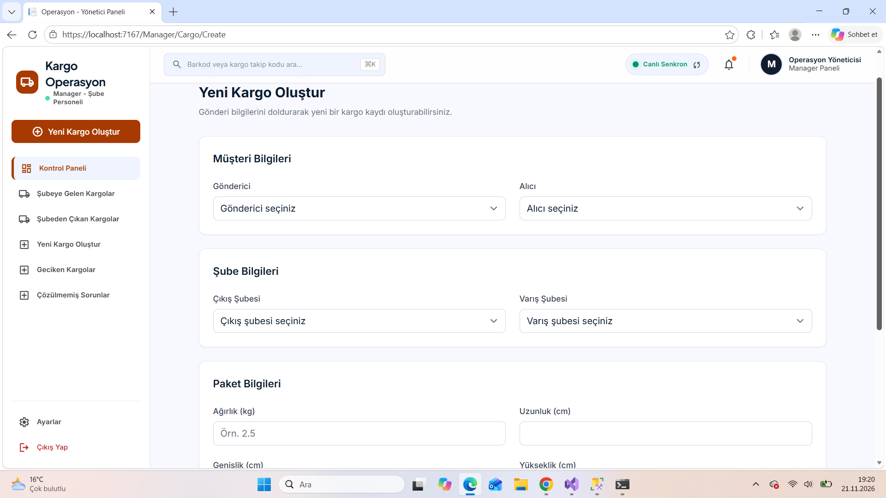
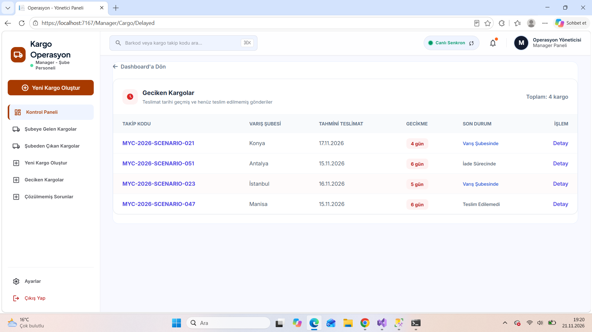
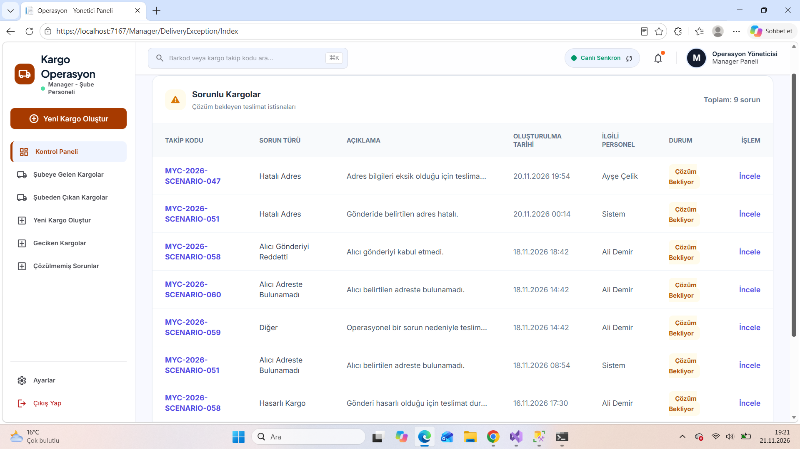

### Müşteri Paneli
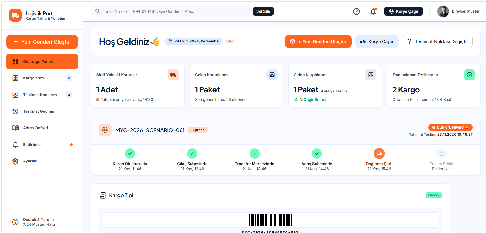
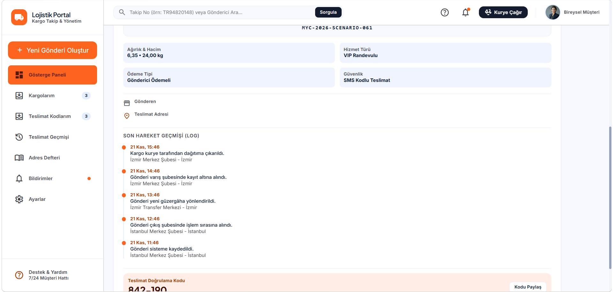
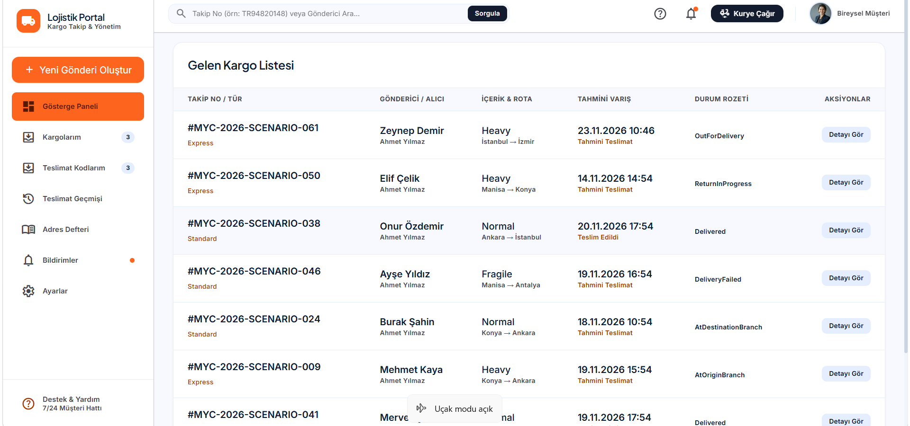
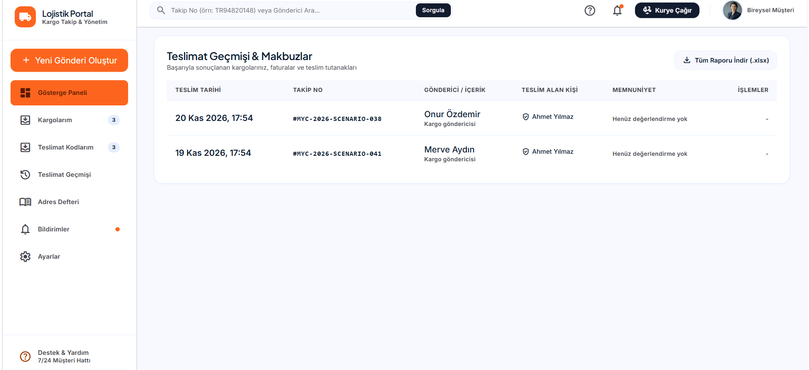

### Veritabanı İlişkileri - Database Diagram
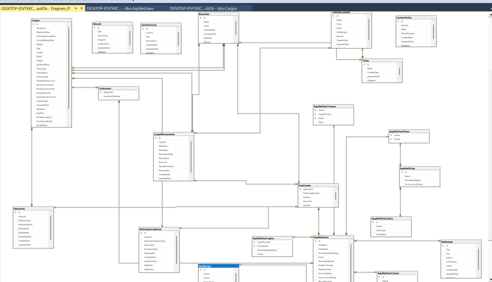
---

# 🎓 Proje Hakkında

CargoTrack, ASP.NET Core MVC ve N-Katmanlı Mimari kullanılarak geliştirilmiş bir portföy ve öğrenme projesidir.

Proje geliştirme sürecinde yalnızca temel CRUD işlemlerine odaklanılmamış; gerçek bir kargo firmasının operasyonel ihtiyaçları dikkate alınarak kargo yaşam döngüsü, şube yönetimi, transfer süreçleri, teslimat işlemleri ve rol bazlı kullanıcı yönetimi gibi farklı iş alanları bir araya getirilmiştir.

Bu proje ile özellikle aşağıdaki konularda uygulamalı deneyim kazanılması hedeflenmiştir:

- ASP.NET Core MVC geliştirme
- N-Katmanlı Mimari tasarımı
- Entity Framework Core ve Code First
- ASP.NET Core Identity
- Rol bazlı yetkilendirme
- Repository ve Service yapıları
- DTO kullanımı
- İş kurallarının yönetimi
- Veritabanı ilişkilerinin tasarlanması
- Git ve GitHub ile versiyon kontrolü

---

# 👩‍💻 Geliştirici

**Elifnaz Demir**

- GitHub: [@Elifnaz00](https://github.com/Elifnaz00)

---

⭐ Projeyi incelemek için repository'yi ziyaret edebilirsiniz.
